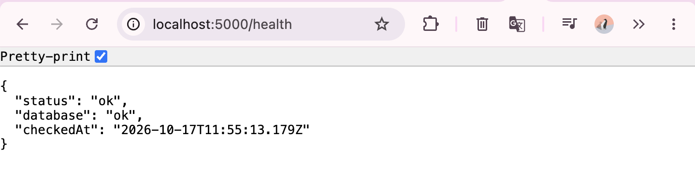

# Staging Verification & Rollback Plan (#81)

## Verification of v3.0-rc1 on staging (<date>)

| Check | Result | Evidence |
|---|---|---|
| Health check `/health` | ok |  |
| E2E journeys (TC-E01, TC-E02) + DEF-007 regression on staging (Edge) | <4/4 passed> | `staging-verification-output.txt` |
| Manual login: requester, staff, management | <all OK> | – |

## When to roll back

- `/health` fails after a deployment, or
- a critical journey (submit, assign, status change) fails, or
- a Must-requirement defect appears that can't be fixed quickly.

## What to roll back to

The previous tagged release (e.g. `v3.0-rc1` → the tag before it). Tags make the exact version identifiable.

## Steps

1. Stop the API and client.
2. Check out the previous tag.
3. Rebuild the client (`npm run build`) and restart the API with the staging config.
4. Verify: `/health` ok, then run the E2E journeys.
5. Record what happened in the defect register.

## Data and configuration concerns

- **Database:** M3 made no schema changes, so the previous version works with the current database. If a future release changes the schema, restore the pre-release backup (#83) **before** rolling back the code.
- **Configuration:** `.env.staging` is unchanged between versions; check it if a release added new settings.
- **Data created after the release** may be lost if a backup is restored; take a fresh backup first.

## Rollback drill
- **Date:** 17 October 2026
- **Previous commit tested:** `fdc7478`
- **Rollback:** Successfully checked out the previous commit and started the staging API.
- **Health check:** `/health` was unavailable in the older commit.
- **Restoration:** Switched back to `80-staging-environment`, restarted the API, and confirmed `/health` was successful.
- **Result:** Restoration successful. Rollback partially verified, as the older version could not be tested using `/health`.
